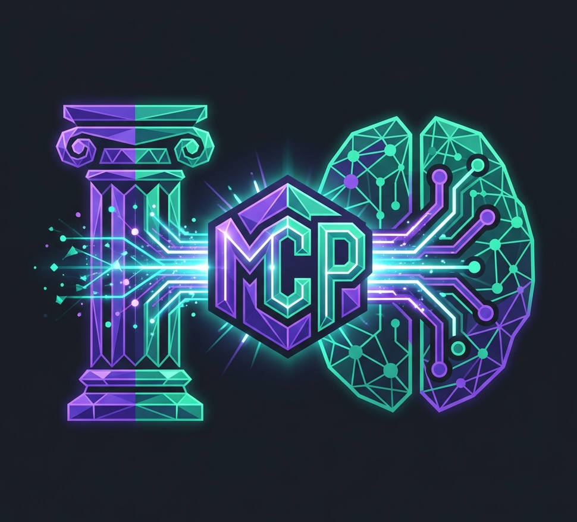

<p align="center">
  
</p>

# MCP for Delphi

   ### Server · Client · Agent — a full-stack MCP toolkit for [DMVCFramework](https://github.com/danieleteti/delphimvcframework)

   [](https://github.com/danieleteti/mcp-server-delphi)
   [](LICENSE)
   [](https://www.embarcadero.com/products/delphi)

   A production-ready [Model Context Protocol (MCP)](https://modelcontextprotocol.io) toolkit for Delphi. It is **not just a server library** — it gives Delphi the complete MCP triangle in one package.

   ## 📖 Full documentation & guide → **[www.danieleteti.it/mcp-server-delphi](https://www.danieleteti.it/mcp-server-delphi/)**

   This README is just a hook. **Every detail — getting started, API reference, the client, the agent, the REST→MCP bridge, configuration and testing — lives in the [official documentation](https://www.danieleteti.it/mcp-server-delphi/).**

   ---

   ## What is this?

   Most "MCP for X" libraries only let you build a *server* the AI calls into. This one gives Delphi **all three corners** of the MCP world:

   | | Role | What it does |
   |---|------|--------------|
   | 🟢 | **Server** | Expose your Delphi tools, resources, and prompts to AI assistants (Claude, Gemini, ChatGPT, …) over HTTP or stdio — attribute-driven, zero boilerplate. |
   | 🔵 | **Client** | Consume *any* spec-compliant MCP server from your own Delphi code with `TMCPClient` (Streamable HTTP) or `TMCPStdioClient` (spawns a server as a child process and talks over pipes). |
   | 🟣 | **Agent** | Drive an MCP server from an LLM with `TMCPOpenAIAgent` — a complete agent loop (tool discovery → LLM round-trips → tool dispatch → token accounting) that works with any OpenAI-compatible model: OpenAI, OpenRouter, Anthropic-compat, Together, Groq, Ollama, vLLM, llama.cpp `--api`. |
   | 🌉 | **REST → MCP Bridge** | Auto-expose an **existing** DMVCFramework REST API as MCP tools by scanning the engine's routes via RTTI. Make your current backend AI-ready without writing a single tool by hand. |

   In short: build AI-powered Delphi applications where Delphi is the **server**, the **client**, *and* the **agent**.

   > 🚀 **MCP with DMVCFramework? Sure — even for on-premises AI engines.**
   >
   > Expose your ERP and let a Delphi-side agent *chain* your tools. Ask:
   > *"Reorder customer C-1024's best-selling product from last March — but only if they're within their credit limit."*
   > The agent finds March's top product, reads the customer's balance, decides, and drafts the invoice — several tool calls, planned on the fly, all against **your** data. 💡

   ## Features at a glance

   - **MCP Protocol 2026-07-28 (current) and 2025-03-26**, served together on the same endpoint and on stdio: the request decides the era (see [Protocol conformance](#protocol-conformance))
   - **Server, client AND agent** in one library — plus a REST→MCP bridge
   - **Attribute-driven** tool/resource/prompt registration using RTTI — no manual wiring
   - **Dual transport**, server *and* client side: Streamable HTTP and stdio
   - **Type-safe** parameter binding with automatic JSON Schema generation
   - **Rich content types**: Text, Image, Audio, Embedded Resources — with a fluent multi-content API
   - **URI resource templates** (RFC 6570 Level 1)
   - **Session management** with automatic cleanup
   - **DMVCFramework integration** via the idiomatic `PublishObject` pattern
   - **Apache 2.0** — free for commercial and personal use

   ## A 30-second taste

   **Expose a tool (server):**

   ```pascal
   [MCPTool('reverse_string', 'Reverses a string')]
   function ReverseString(
     [MCPParam('The string to reverse')] const Value: string
   ): TMCPToolResult;
   ```

   **Call a server (client):**

   ```pascal
   LClient := TMCPClient.Create('http://localhost:8080/mcp');
   LClient.Initialize;
   WriteLn(LClient.CallTool('reverse_string',
     TJSONObject.Create.AddPair('Value', 'hello')));
   ```

   **Drive a server from an LLM (agent):**

   ```pascal
   LAgent := TMCPOpenAIAgent.Create('http://localhost:8080/mcp', LApiKey, 'gpt-4o-mini');
   LAgent.SystemPrompt := 'You are a helpful Delphi-powered assistant.';
   LResult := LAgent.Run(LUserMessages);   // tool discovery + LLM loop + dispatch
   WriteLn(LResult.Content);
   ```

   👉 **Full, runnable examples and the complete API are in the [documentation](https://www.danieleteti.it/mcp-server-delphi/).**

   ## Quick Start

   Copy a ready-to-run Quick Start project and customize it — all share the same provider units in [`quickstart/shared/`](quickstart/shared/):

   | Project | Role | Transport | Use when |
   |---------|------|-----------|----------|
   | [`quickstart/quickstart/`](quickstart/quickstart/) | Server | HTTP + stdio | You want a network server AI clients connect to via HTTP |
   | [`quickstart/quickstart_stdio/`](quickstart/quickstart_stdio/) | Server | stdio only | You want the AI client (e.g. Claude Desktop) to launch the server locally |
   | [`quickstart/quickstart_stdio_agent/`](quickstart/quickstart_stdio_agent/) | **Agent (host+client)** | stdio | You want a Delphi-side AI agent that spawns and consumes a stdio MCP server, driven by an LLM |

   Open the `.dproj` in Delphi, add DMVCFramework and this repo's `sources/` to the search path, build, run. Step-by-step instructions, IDE wiring, and how to connect Claude Desktop / Gemini CLI / Claude Code / Continue are all in the **[documentation](https://www.danieleteti.it/mcp-server-delphi/)**.

   ## Protocol conformance

The library is **dual-era**, as the specification allows (Versioning and Compatibility, "Dual-era"):

| Era | Spec | How a client opens | Sessions |
|---|---|---|---|
| Modern | **2026-07-28** (current) | Any request whose `params._meta` carries `io.modelcontextprotocol/protocolVersion`. `server/discover` is optional. | None. `Mcp-Session-Id` is ignored and never sent |
| Legacy | 2025-03-26 | `initialize`, then `notifications/initialized` | `Mcp-Session-Id`, as before |

Existing clients and servers keep working with no change: a request with no version in `_meta` is a legacy request, and `TMCPClient`, `TMCPStdioClient` and `TMCPOpenAIAgent` speak the legacy era unless told otherwise.

**Implemented from 2026-07-28:** per-request `_meta` (version, client info, client capabilities); `server/discover`; `resultType` and the server info in every result; `ttlMs` and `cacheScope` on the lists and on `server/discover` (`ListCacheTTLms`, 60 s by default; `private` for an authenticated caller); tools listed in a deterministic order; the `MCP-Protocol-Version`, `Mcp-Method` and `Mcp-Name` headers validated against the body (`400` and `-32020`, `=?base64?...?=` decoded); `UnsupportedProtocolVersionError` (`400` and `-32022`, with `supported` and `requested`); `-32602` for a missing capabilities field, an unknown tool and a resource not found; `404` and `-32601` for an unknown method. Authentication does not change: `MCPGuard` and a JWT middleware stand in front of both eras and the tools see the same `Caller`.

**Implemented from 2025-06-18 and later:** tool `title` and `annotations` (`[MCPToolTitle]`, `[MCPReadOnly]`, `[MCPNonDestructive]`, `[MCPIdempotent]`, `[MCPClosedWorld]`).

**Client:** `Era := mpeModern` or `mpeAuto` on `TMCPClient`, `TMCPStdioClient` and `TMCPOpenAIAgent.MCPEra`. `mpeAuto` tries the modern era and falls back to the handshake when the server does not know it. `TMCPClient.BearerToken` (agent: `MCPBearerToken`) sends the identity of the user.

**Not implemented** (none is needed for a server made of tools, resources and prompts):

- `subscriptions/listen`, `resources/subscribe` and the list-changed notifications: the registry is fixed once the server serves.
- Multi round-trip requests (`input_required`), and with them elicitation, sampling and roots. Sampling, roots and logging are deprecated by the specification.
- The tasks extension, `structuredContent` and `outputSchema`, pagination (`nextCursor`), `completion/complete`, icons, `x-mcp-header`.
- The OAuth 2.1 authorization flow and the protected-resource metadata. Use `MCPGuard` (static token) or a JWT middleware.
- The HTTP+SSE transport of 2024-11-05 (deprecated).

## Testing ✅

   Tested by six compliance suites: a Python HTTP suite (200 cases), a Python stdio suite (160 cases), a Python suite for the 2026-07-28 era (69 cases, over HTTP and stdio), a Python security suite (132 cases: the REST-to-MCP bridge filters, `MCPGuard`, the caller identity and a JWT middleware in front of `/mcp`; it starts the test server itself, once per configuration), a `TMCPClient` suite (21 Delphi cases, run over HTTP and stdio, in the legacy, modern and auto eras), and a `TMCPOpenAIAgent` suite (32 Delphi cases driving the agent loop, and the SSE stream reassembly, against an embedded fake LLM). The stdio suite also runs against any other stdio MCP server with `--server-independent` (70 cases against the test server; it skips the cases that name a tool, resource or prompt of the library's own test server). See the [documentation](https://www.danieleteti.it/mcp-server-delphi/) for how to build and run them.

   ## Requirements

   - Delphi 11+ (Alexandria) or later
   - DMVCFramework 3.5.x

   ## License

   Apache License 2.0 — see [LICENSE](LICENSE).

   ## Links

   - 📖 **[Official Documentation & Full Guide](https://www.danieleteti.it/mcp-server-delphi/)** ← start here
   - [Model Context Protocol Specification](https://modelcontextprotocol.io/specification/2026-07-28)
   - [DMVCFramework](https://github.com/danieleteti/delphimvcframework)
   - [Issue Tracker](https://github.com/danieleteti/delphimvcframework/issues)

---

   Built with ❤️ by Daniele Teti
